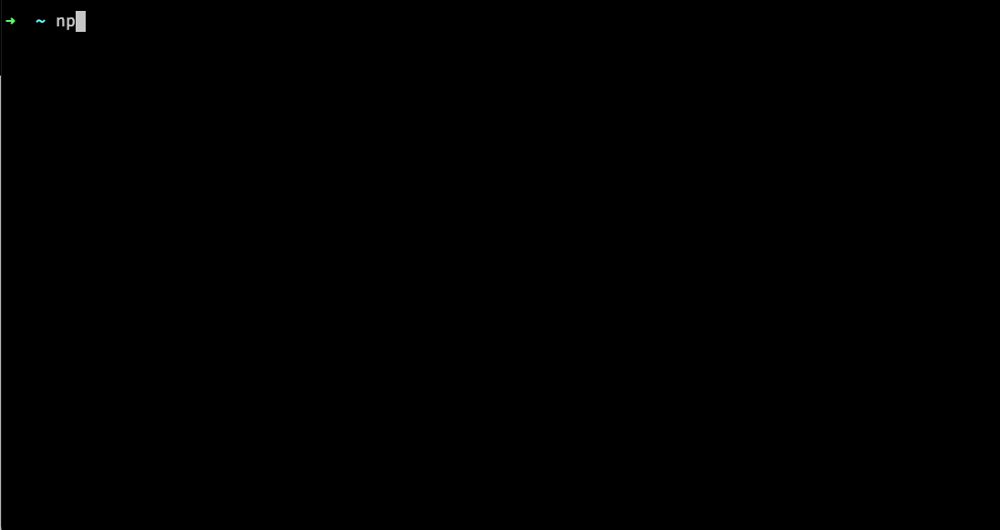

# Package Size (pkgsz)

[](https://www.npmjs.com/package/pkgsz)

Get the size of an npm package.

## Usage

```bash
npx pkgsz [flags] <package name> [version]
```

## Requirements

- Node.js `^22.22.2 || ^24.15.0 || >=26.0.0`

## Example



## :bulb: Features

- Uses rollup to build the package (probably more accurate results in the modern vite world)
- Reports the statistics regarding node_modules size and minified / gzipped size (brotli compression is optional)
- Supports subpath exports
- Supports custom registries (without authentication)
- Audits the installed package and its production dependencies for known vulnerabilities using npm
- Interactive mode

## :bell: Limitations

- If you are using something like angular size will be incorrect because this tool does not include the angular compiler (or any other UI framework / library compiler)
- Only reports sizes in binary units (Kib, Mib, bytes)
- Installs using `npm install` and not `yarn` / `pnpm` / `bun` etc.

## :key: Options

### -i, --interactive

Interactive mode (default: false)

### -b, --brotli

Calculate brotli compressed size

### -c, --no-clean

Do not clean the temporary directory

### -g, --no-gzip

Do not calculate gzipped size

### -e, --export

Reexport given subpath from the package (default: ["."])

### -r, --registry

The npm registry to use when installing and auditing the package

### --audit-registry

Override the registry for auditing only. Auditing uses `--audit-registry`, then
`--registry`, then npm's configured registry. For example, install from a private
registry and audit against npm:

```bash
npx pkgsz lodash --registry https://registry.example.com --audit-registry https://registry.npmjs.org
```

### --no-audit

Disable auditing (auditing is enabled by default).

### --audit=summary|full

Show a summary by default (`--audit=summary`), or use `--audit=full` to include
affected packages, advisory titles, and links:

```bash
npx pkgsz lodash --audit=full
```

The terminal summary is green when no known vulnerabilities are found. Nonzero
severity counts are cyan (info), blue (low), yellow (moderate), red (high), or
bright red (critical); zero counts are dimmed. Colors follow terminal support.

Auditing runs in the temporary directory after installation, using the generated
lockfile. It checks the target package and its resolved production dependency
tree, including transitive dependencies, independently of selected exports or
tree shaking. The package author's development dependencies are not included.

Findings are informational and do not change the exit code. An audit failure
(such as an unavailable or unsupported registry endpoint) is reported alongside
the size results and causes exit code 1. pkgsz does not automatically switch to
another registry or apply fixes. Audit requests send dependency names and versions
to the selected registry's security endpoints.

With `--json`, an `audit` object contains `status` (`complete` or `error`) and
`provider` (`npm`). Completed audits include a `summary` of affected packages by
severity and a unique `advisoryCount`. With `--audit=full`, the object also includes
npm's `vulnerabilities` details (including advisory links, affected ranges,
dependency paths, and available fixes). JSON output contains no color codes.
Failed audits contain an `error` message. With `--no-audit`, the `audit` field is omitted.

### -s, --enable-scripts

Enable scripts

### -j, --json
Output results as JSON

### -h, --help

Show help

### --version

Show version

# :information_source: License

[MIT](https://github.com/kshutkin/package-size/blob/main/LICENSE)
